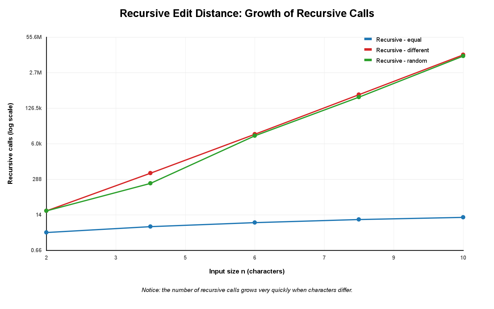
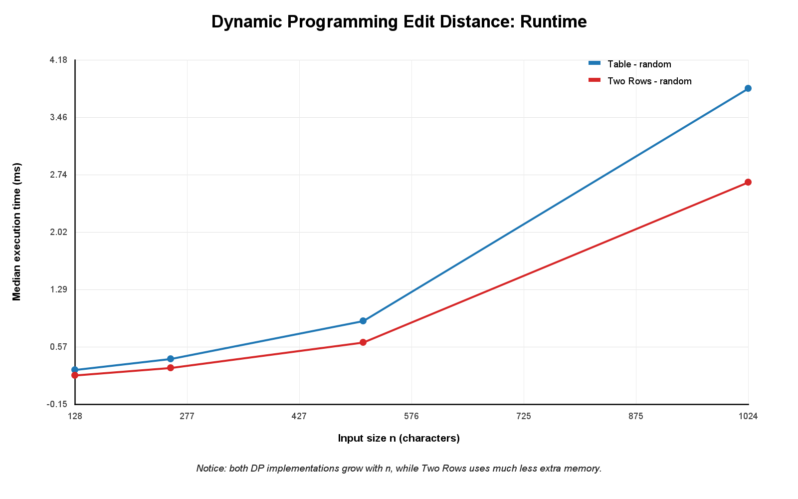
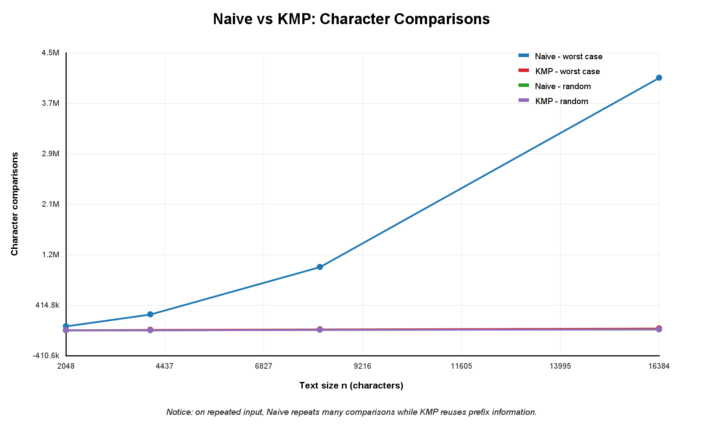
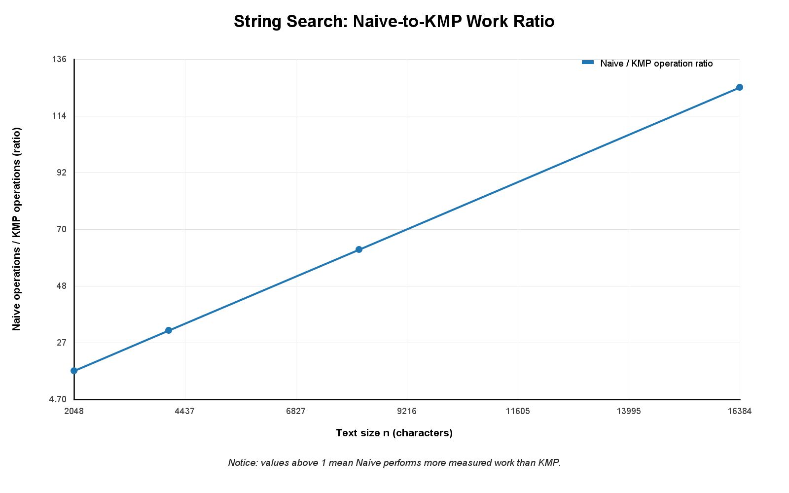

# Assignment 4 — Dynamic Programming and String Algorithms

**Student:** Aisha Kazbekova  
**Group:** SE-2518

---

# 1. Experiment Design Card

## Edit Distance

### Question

How does the cost of the three Edit Distance implementations change when the input size increases?

I also wanted to compare the full dynamic programming table with the memory-optimized two-row version.

### Sizes

For Recursive Edit Distance I used:

`n = 2, 4, 6, 8, 10`

I used small sizes because the recursive algorithm becomes expensive very quickly.

For Table and Two Rows I used:

`n = 128, 256, 512, 1024`

These implementations can handle larger inputs because they do not repeatedly solve the same subproblems.

### Input Types

I used three input types.

**Equal strings**

Example:

`AAAA` and `AAAA`

This case shows what happens when corresponding characters are already equal.

**Different strings**

Example:

`AAAA` and `BBBB`

This input forces the algorithms to process differences between the strings.

**Random strings**

Random strings were generated using a fixed seed.

This gives a reproducible input that is less artificial than the two special cases.

### Metrics

I measured:

- execution time in milliseconds;
- number of operations performed inside the algorithms.

For Recursive Edit Distance, the operations counter represents recursive calls.

For Table and Two Rows, it represents processed dynamic programming states.

### Prediction

I expected the recursive implementation to become expensive very quickly because the same subproblems are calculated many times.

I expected Table and Two Rows to show approximately quadratic growth because both process combinations of positions from the two strings.

I also expected Two Rows to require less additional memory than the full table.

---

## String Search

### Question

How do Naive Search and KMP behave when the text size increases, especially on inputs that contain repeated prefixes?

### Sizes

I used text sizes:

`n = 2048, 4096, 8192, 16384`

The pattern size also increased together with the text size.

### Input Types

I used three types of input.

**Random**

The text and pattern contain randomly generated characters.

This represents a more general input.

**Repeated worst-case-like input**

The text contains repeated `A` characters.

The pattern contains many `A` characters followed by `B`.

Example:

Text:

`AAAAAAAAAAAAAAAA`

Pattern:

`AAAAAAAB`

This is difficult for Naive Search because it can compare almost the entire pattern before finding a mismatch.

**Alternating**

Example:

`ABABABABABAB`

This input contains repeated prefix and suffix structures and is useful for observing how KMP uses the LPS array.

### Metrics

I measured:

- execution time in milliseconds;
- number of character comparisons.

The comparison counters are increased inside the search algorithms.

### Prediction

I expected Naive Search to perform many repeated comparisons on the repeated-character input.

I expected KMP to perform fewer comparisons because the LPS array allows it to reuse information about previously matched characters.

---

# 2. Results and Plots

## Plot 1 — Recursive Edit Distance

**Takeaway:** The recursive algorithm becomes much more expensive when it cannot simply continue through matching characters. The growth is large enough that a logarithmic scale is useful for displaying the results.

The equal-string input requires relatively little recursive work because matching characters allow the algorithm to move directly to the smaller subproblem.

When the characters differ, the recursive version explores deletion, insertion and replacement possibilities. Because it has no memoization, many of the same subproblems are calculated repeatedly.

This explains why the recursive implementation can only handle relatively small values of `n`.

---

## Plot 2 — Dynamic Programming Edit Distance

**Takeaway:** Both dynamic programming implementations can handle much larger input sizes than direct recursion.

The Table and Two Rows implementations calculate the same Edit Distance result and process the same general set of dynamic programming states.

Their running times therefore have similar growth behaviour.

The important difference is memory.

The Table implementation stores the complete `(n + 1) × (m + 1)` table.

The Two Rows implementation only keeps the previous row and the current row.

Therefore, Two Rows obtains the same final distance while using substantially less additional memory.

---

## Plot 3 — Naive vs KMP Comparisons

**Takeaway:** The largest difference between Naive Search and KMP appears on the repeated worst-case-like input.

Naive Search begins matching the pattern at every possible starting position.

For the repeated input, many `A` characters match before the final `B` causes a mismatch.

The algorithm then starts again from the next position and repeats many of the same comparisons.

KMP behaves differently.

It first builds the LPS array. When a mismatch happens, KMP uses information from LPS instead of restarting the comparison from the beginning.

This reduces repeated work.

---

## Plot 4 — Naive/KMP Work Ratio

**Takeaway:** A ratio greater than `1` means that Naive Search performed more measured comparison work than KMP.

This plot makes the difference between the algorithms easier to see than raw execution time alone.

Execution time may change slightly between runs because it depends on the computer and JVM state, but the operation counters describe the work performed by the algorithms directly.

---

# 3. Prediction vs Result

## Edit Distance

My prediction was that the direct recursive implementation would become expensive much faster than the dynamic programming implementations.

The measurements support this prediction.

For equal strings, recursion can move directly through matching characters. For more difficult inputs, the recursive algorithm creates several recursive branches and repeatedly calculates the same states.

The Table and Two Rows implementations avoid this repeated work by calculating each dynamic programming state systematically.

I also predicted that the Table and Two Rows versions would have similar runtime growth but different memory requirements.

This prediction was also consistent with the implementations. Both versions perform the dynamic programming calculation, but Two Rows stores only two rows instead of the complete table.

---

## String Search

My prediction was that the repeated-character input would make Naive Search perform much more work.

The measured comparison counts support this prediction.

Naive Search repeatedly compares a long matching prefix before finding the mismatch near the end of the pattern.

KMP uses the LPS array to determine how much of the previous match can still be reused.

As a result, KMP avoids many repeated character comparisons.

For simpler or random inputs, the difference can be smaller because Naive Search often discovers a mismatch early.

---

# 4. Short Answers

## Which input made the string search slowest, and why?

The repeated worst-case-like input was the most difficult input for Naive Search.

The text consisted mainly of `A` characters, while the pattern contained many `A` characters followed by `B`.

Naive Search matched many characters before finding the mismatch near the end of the pattern. It then repeated similar comparisons from the next starting position.

KMP handled this input better because its LPS array allowed it to reuse information from previous comparisons.

---

## How large an n could the recursive Edit Distance handle, and what stopped it?

In my experiment I limited Recursive Edit Distance to `n = 10`.

The problem is not that the final answer is difficult to store, but that direct recursion repeatedly solves the same subproblems.

When two characters are different, the algorithm can create recursive calls for insertion, deletion and replacement.

The number of calls therefore grows very quickly, so using much larger input values would make the experiment unnecessarily slow.

---

## What do you gain and what do you lose when you use two rows instead of the full table?

The main advantage of Two Rows is lower memory usage.

The full Table implementation stores all dynamic programming states in an `(n + 1) × (m + 1)` matrix.

Two Rows only stores the previous row and the current row, so its extra memory is linear in the shorter string length.

The final Edit Distance value is still the same. However, because the complete table is not preserved, information from old rows is no longer available if we later wanted to reconstruct the exact sequence of edits.

---

## If you had to choose one string search for the city platform, which one and why?

I would choose KMP for searching long text.

Both Naive Search and KMP return the same match positions, including overlapping matches.

However, KMP avoids restarting the pattern comparison from the beginning after every mismatch.

Its LPS preprocessing makes the behaviour more reliable on difficult repetitive inputs, which is useful when searching large log files or other long texts.

---

# 5. Time Measurements

Execution time was measured using `System.nanoTime()` and converted to milliseconds.

Each experiment case was measured five times after a warm-up call. The plots use the median value instead of relying on a single timing result.

Timing is useful, but it is not the only evidence because wall-clock measurements depend on the computer, the JVM, background processes and other system activity.

For this reason, I also recorded counters inside the algorithms. The counters make it possible to compare the amount of algorithmic work even when measured execution times vary slightly between runs.

---

# Conclusion

This assignment demonstrated the difference between direct recursion, dynamic programming and optimized string matching.

For Edit Distance, direct recursion is simple but repeats a large amount of work. The full DP table removes this repetition, while the Two Rows version keeps the same final result with much lower memory usage.

For